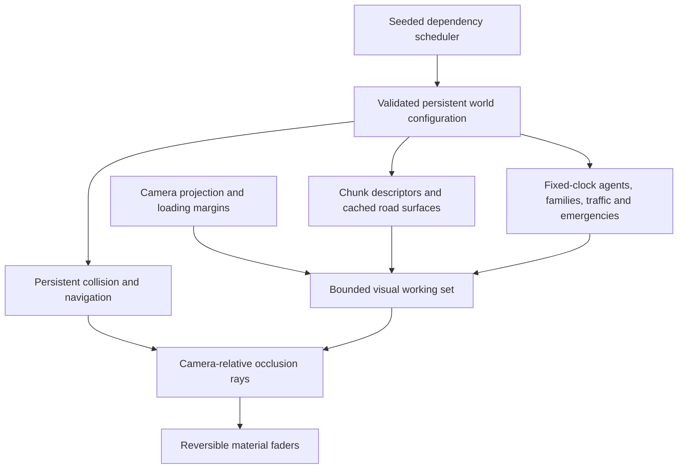

# Advanced generation, visibility and rendering

## Inspection and architecture

The existing project separates fixed-clock simulation dictionaries (`simulation_manager.gd`, `social_simulation.gd`) from read-only Godot avatars. Its shared `city_map.gd` already supplies road graphs, obstacles, rooms, shelters and terrain. Those interfaces remain authoritative.

The initial inspection and GPU baseline identified eager city construction twice at view startup, an obstacle-by-cell full-map scan in the auxiliary navigation mesh, all 100 avatars instantiated, all building detail instantiated, and instant material-alpha changes. Existing physics ray occlusion, primitive factories, road triangulation, navigation, recording/replay and background world-generation worker were reused.

The new boundaries are:



There is no simulation culling. A missing avatar or unloaded building facade does not remove an agent, pause a decision, clear memory, change occupancy, disable a road or reset vehicle motion. Selecting an off-screen agent creates/pins its avatar so the existing focus/follow controls still work.

## Generation priorities and shelter reservations

`generation_pipeline.py` schedules registered `Stage` objects by dependencies, then descending priority, with a stable name tie-break. Registration order is irrelevant. Missing dependencies, duplicate names and cycles are rejected before stage execution. Priorities are configurable under `stage_priorities` in `resources/world_generation.json`; a high priority never bypasses an unmet dependency.

`world_stages.py` supplies independent geography, districts, shelter reservations, layout, infrastructure, environment and validation modules. Infrastructure and environment share a layout prerequisite and can be prioritized independently. The existing planar street/parcel generator remains the layout implementation rather than a second road/navigation system.

`shelter_generation.py` reserves the final S1–S5 structures and their entrance corridors before roads and buildings. Roads adapt to these reservations: candidate streets and connectivity repairs avoid their clearance envelopes; shelter approach roads choose unobstructed connections; highway/ramp placement checks the reservations. Buildings, parking and scenery reserve the same plazas and connectors. Final validation and the existing runtime navigation checks still reject unreachable shelters. Capacities, S5 existence/privacy, real admission and evacuation logic retain their existing interfaces.

The pipeline uses content-addressed artifacts keyed by stage version, explicit inputs and dependency outputs. Vegetation edits reuse geography, districts, shelter reservations, roads/parcels and infrastructure. Pure deterministic placement failures are also cached so a retry does not recompute an already rejected layout. Corrupt cache entries are discarded; user map loads remain strict. Input/output copies prevent a downstream stage from mutating a cached prerequisite.

The CLI stores stage artifacts under `user://worlds/cache/stages`; complete-world cache keys also include generator configuration. Bump an affected stage version when changing its implementation. The layout artifact additionally includes the city-generator version. New worlds use `essaim-world-3`, with 70% straight street links by default; exact saved `essaim-world-1` and `essaim-world-2` worlds remain loadable without regeneration. Existing independent RNG streams and canonical JSON persistence are preserved.

## Chunk residency and visual reconstruction

`visual_chunk_manager.gd` indexes persistent building, vegetation, prop and road records by world-space cell. Each descriptor records its boundary, asset IDs, visible/near flags, construction cursor and state:

`UNLOADED → QUEUED → LOADING → ACTIVE → POOLED / UNLOADED`.

Camera projection of chunk corners and local height bounds determines residency; this accounts for isometric depth rather than comparing only world X/Y. A preload margin admits nearby chunks and a larger unload margin provides hysteresis. Construction prioritizes nearby chunks and is spread across frames using a time target and building count limit. There is no asynchronous scene-tree mutation: world data generation runs on the existing worker; Node/mesh integration happens on the main thread.

Detailed terrain tiles, road meshes, building scenes, local signs/lights, MultiMesh vegetation and MultiMesh props exist only in resident chunks. Road triangulation is partitioned into chunk vertex buffers; each triangle has one owner. These are persistent data, not eagerly instantiated meshes. A cheap world overview supplies coarse terrain, true-width road ribbons and building proxies while zoomed out or awaiting detailed chunks. A proxy disappears as its detailed building appears. Closer zoom restores existing facade/window/weathering detail.

Chunk pooling retains at most two complete chunks by default. Identity-based avatar pooling retains at most 24 inactive agents; excess nodes are freed and later reconstructed from the same live record. A returning pooled avatar adopts current vehicle state without replaying boarding events that happened off-screen. Vehicle meshes are reconstructed from current vehicle records, while their lightweight physical bodies remain present. Mesh-factory lookups release the previous world's entries on a world change; live nodes retain their resource references safely.

## Collision, navigation and compatibility

`building_shape.gd` extracts the original deterministic structural recipe. Both building art and persistent collision use its dimensions, wings, rotation and interior door gaps. Streamed building scenes omit duplicate bodies. `static_world_collision.gd` owns the full-map structures, live door colliders, trees/props and exact terrain triangles. Terrain collision preserves the authoritative triangle diagonal and border heights. Curbs/sidewalks retain their original global collision surfaces. Transparency never changes these bodies.

The auxiliary Godot navigation mesh remains available across the whole map. Its obstacle lookup now uses the existing spatial index rather than scanning every building for each grid cell. The simulation's established road/free-space navigation and traffic conventions remain unchanged.

Traffic-light and streetlight placement is computed once per world, then shared by persistent colliders and chunk visuals. Previously, recomputing placements per loaded chunk caused multi-second hitches; caching removed that bottleneck. Vehicle-runtime reset clears a stale previous-world physics reference before initializing another population.

Damage is addressed by original building ID rather than the active-array position. Loaded, pooled and later-reconstructed buildings retain destruction state; collision changes follow those same records. Vegetation/props and road scorch visuals also recover damage when their chunks become resident. Existing shelter nodes, warning/audio infrastructure and small background scenery remain resident because they are bounded and support existing interactions/audio; their records are not duplicated into a competing simulation.

## Conditional transparency

The existing orthographic camera-ray technique is retained. Queries begin at `camera.project_ray_origin(camera.unproject_position(target))` and end at the relevant visible agent. This keeps parallel orthographic rays correct away from the screen center. A bounded series of exclusions finds stacked obstructions. Persistent building-body IDs resolve to their resident visual node, avoiding an agent-by-building Cartesian scan.

Conflicts are aggregated over agents. A building remains faded while any relevant conflict persists; a short restore delay prevents boundary flicker. The same system supports vault/shelter structures. Unloaded nodes reset their fade before pooling.

`material_fader.gd` provides smooth, interruptible transitions. It duplicates affected materials locally, supports override materials and imported mesh surface materials, and restores the original material references, transparency mode, alpha, textures and other properties. Shared mesh materials and unrelated instances are never modified. No collision layer, shape or navigation data is changed by fading. Interior cutaway behavior remains supported.

## Configuration and monitoring

Edit `resources/render_streaming.json` and restart to apply consistently. `render_options.gd` loads and normalizes it once so road partitioning and chunk residency use identical dimensions.

| Setting | Default | Meaning |
| --- | ---: | --- |
| `enabled` | `true` | Stream visuals; false is a diagnostic full-residency mode. |
| `chunk_size` | `1200` | Simulation units: 120 m per side. Rounded to multiples of 120, bounded 600–2400. |
| `preload_distance` | `360` | 36 m projected loading margin. |
| `unload_distance` | `720` | 72 m margin; normalized larger than preload. |
| `update_interval` | `0.15` | Residency/LOD update seconds. |
| `frame_budget_ms` | `4` | Construction scheduling target; a single mesh/scene operation is not preempted. |
| `buildings_per_frame` | `2` | Limits building scene construction per frame. |
| `pooled_chunks`, `pooled_agents` | `2`, `24` | Bounded inactive visual caches. |
| `detail_view_size` | `420` | Orthographic view size above which overview LOD is used. |
| `facade_view_size` | `150` | View size below which window/weathering detail is shown. |
| `detail_distance` | `220` | Additional distance visibility range for building detail meshes. |
| `occlusion_interval` | `0.12` | Camera-ray update interval. |
| `max_occlusion_layers` | `12` | Bounded ray exclusions per target. |
| `occlusion_alpha` | `0.18` | Temporary obstructing-material opacity. |
| `fade_seconds` | `0.25` | Fade/restore duration. |
| `restore_delay` | `0.22` | Conflict-release hysteresis. |
| `show_metrics` | `false` | Initial metrics visibility. Press **F10** with the map focused to toggle. |

The metrics display includes FPS, process time, live avatar/pool counts, loaded/pending/pooled chunks, maximum loading/unloading work, object count and static memory. `city.streamer.metrics()` exposes the chunk counters directly. Actual GPU measurements below come from the rendered application, not headless FPS.

## Profiling and verification

The benchmark uses a large seed-42 world, 100 real agents, rule-only decisions, no automatic warning, an orthographic view size of 180, and six simulated seconds over 180 measured frames after 120 warm-up frames. It records CPU/frame timing, FPS, nodes/objects, active visuals, static memory, draw calls, GPU memory and chunk timings. Baseline and optimized runs load the exact same archived world ID (`essaim-42-523b32dd3818c2af`) rather than comparing different generated maps. GPU: NVIDIA GeForce RTX 5070 Ti Laptop GPU, Godot 4.7.2 Compatibility renderer.

Raw artifacts are `outputs/streaming/baseline.json`, `baseline-world.json` and the optimized `after-*.json` files. The final run is `after-steady.json`; it waits for the visible working set to finish loading before the 120 warm-up frames. `startup_ms` measures synchronous view construction after world/population initialization; detailed chunks continue populating over subsequent frames. It does not include the separate world-generation job. The archived baseline must be retained to reproduce this exact comparison.

| Measurement | Eager baseline | Optimized working set |
| --- | ---: | ---: |
| Synchronous view construction | 45,757 ms | 7,819 ms |
| Visible working set ready, before warm-up | Already constructed | 8,856 ms from construction start |
| Median measured frame | 11.77 ms | 7.34 ms |
| 95th-percentile measured frame | 29.95 ms | 25.28 ms |
| Scene nodes | 21,656 | 13,723 |
| Detailed buildings instantiated | 243 | 97 |
| Agent avatars instantiated | 100 | 36 |
| Simulation agents | 100 | 100 |
| Draw calls | 2,247 | 1,777 |
| Godot static memory, decimal MB | 845.0 | 449.0 |
| Reported GPU memory, decimal MB | 88.2 | 63.4 |
| Maximum chunk construction step | Not applicable | 17.19 ms |

The engine's one-second FPS sample varied substantially in the hidden-window runs: 65 in the baseline and 38–88 in optimized runs. The final timed 180-frame sample measured approximately **72 FPS** from accumulated frame durations; the baseline did not record that additional statistic. These FPS quantities should not be treated as interchangeable or used to claim a fixed percentage FPS gain. The matched-world frame percentiles, node counts, draw calls, construction times and memory measurements establish the improvements above. Periodic simulation work remains present in the frame-time tail.

Chunk tuning was measured rather than assumed: 1,800-unit chunks reached roughly 36 ms construction steps after placement caching; the 1,200-unit default reduced that to roughly 15–17 ms. The 4 ms scheduler target remains soft because an individual mesh operation cannot be preempted.

For data-generation profiling, a cold small-world pipeline took about 907 ms and a vegetation-only edit about 153 ms. Nine stage-cache hits (including a deterministic rejected attempt) and two changed-stage misses were observed; road and shelter data were identical. See `outputs/streaming/pipeline-profile.json`.

```powershell
.venv\Scripts\python.exe -m unittest discover -s tests -p test_generation_pipeline.py
.venv\Scripts\python.exe -m unittest discover -s tests -p test_world_generation.py
$godot = "C:\Users\Moham\Downloads\godot\Godot_v4.7.2-stable_win64_console.exe"
& $godot --headless --path . --script tests/test_visual_streaming.gd
& $godot --headless --path . --script tests/test_world_generation.gd
& $godot --headless --path . --script tests/test_world_ui.gd
# Rendered benchmark; run alone for useful frame timing:
& $godot --path . --rendering-method gl_compatibility --script tests/benchmark_visual_streaming.gd -- after-review
# Actual generated-world screenshots:
& $godot --path . --rendering-method gl_compatibility --script tests/render_advanced_world.gd
```

The streaming suite checks a large generated world, repeated camera trips, unique resident building IDs, bounded pools, unchanged agent state during camera-only changes, off-screen movement, persistent vehicle bodies, real police evacuation integration, terrain ray heights, interrupted fades, multiple occluded agents, camera viewpoint changes, material restoration/shared-material isolation and damage reconstruction after unloading. World suites cover all size presets, shelter access and recording/replay. Pipeline tests cover priorities/dependencies, cycle/missing/duplicate rejection, persistent incremental cache reuse and road clearance around prior shelter reservations.

Verification on 2026-11-11:

| Suite | Result |
| --- | ---: |
| Dependency scheduler/incremental cache | 4 Python tests passed |
| Seeded world/persistence acceptance | 9 Python tests passed |
| Visual streaming/occlusion/physics/reconstruction | 190 checks passed |
| Generated-world integration, all presets | 79 checks passed |
| Generated-world main-scene/replay | 12 checks passed |
| Organized police evacuation | 43 checks passed |
| Existing city/navigation/foundations | 4,107 checks passed |
| Traffic/accident/vehicle integration | 1,416 checks passed |
| Daily-life simulation | 1,881 checks passed |
| Phase 7 main-scene integration | 11 checks passed |

All eight listed Godot suites pass (7,739 checks), alongside the 13 Python tests. The editor import reports no script/parse/load errors, whitespace checks pass, and the local Graphify graph was rebuilt. Rendered street and overview captures were inspected at `outputs/streaming/advanced-street.png` and `advanced-overview.png`.

## File map

| Files | Responsibility |
| --- | --- |
| `ai_service/generation_pipeline.py`, `shelter_generation.py`, `world_stages.py` | New scheduler/cache and generation modules. |
| `ai_service/world_generation.py`, `city_generator.py`, `resources/world_generation.json`, `scripts/world_generation_manager.gd` | Integrate reservations, priorities, versioned artifacts and old-world loading. |
| `scripts/three_d/visual_chunk_manager.gd`, `render_options.gd`, `resources/render_streaming.json` | Residency, queues, bounded pools, LOD, settings and metrics. |
| `scripts/three_d/building_shape.gd`, `static_world_collision.gd` | Shared structure recipes and persistent physics. |
| `scripts/three_d/material_fader.gd`, `building_3d.gd`, `shelter_3d.gd`, `isometric_visibility.gd` | Shared conditional opacity, material restoration and camera rays. |
| `scripts/three_d/city_3d.gd`, `city_details.gd`, `valley_environment.gd`, `road_navigation_3d.gd`, `geometry.gd` | Scene integration, cached contextual placement, chunk road geometry, indexed navigation and resource reuse. |
| `scripts/map_view_3d.gd`, `scripts/three_d/social_world.gd`, `scripts/vehicle_runtime.gd` | Identity-based avatars, vehicle visuals, persistent bodies and clean physics binding between runs. |
| `tests/test_visual_streaming.gd`, `test_generation_pipeline.py`, `benchmark_visual_streaming.gd`, `render_advanced_world.gd` | New verification, benchmark and visual inspection. |
| `tests/test_world_generation.py`, `test_world_ui.gd` | Update assertions for versioned archetypes and streamed inventory. |

## Remaining limits

- Persistent collision/navigation and compiled world descriptions still scale with map size. They are deliberately retained outside the view to preserve physical and navigation behavior.
- Chunk scene/mesh integration is progressive main-thread work. The budget is a soft scheduling target; it cannot preempt one primitive mesh build. Cold road triangulation/partition preparation and initial persistent geometry can still cause a startup pause. Background world generation and stage caching do not make every renderer setup operation asynchronous.
- Fast camera teleports can outrun preloading. Overview/proxy geometry provides continuity while nearby detailed chunks arrive; this is not a guarantee of zero visible detail changes at every speed. Normal movement benefits from loading margins and unload hysteresis.
- Road/parcels remain one reused layout artifact. Vegetation changes are incremental; arbitrary edits to one street/building are not yet an interactive district editor.
- Fading supports StandardMaterial3D, including imported mesh surfaces. Custom ShaderMaterial implementations need their own compatible opacity parameter. MultiMesh foliage is optimized as a batch rather than fading individual trees.
- Full-map overview is intentionally simplified. Detailed facades appear on closer zoom. GPU results are measurements on this machine/scenario, not guarantees for other hardware or every event combination.
- Existing engine resource/ObjectDB shutdown notices and replay float warnings remain. Assertions, script errors and frame metrics should be checked separately.
