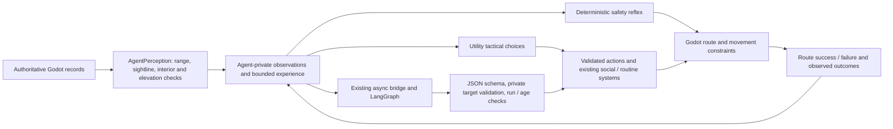

# Phase 3 — autonomous humanoid agent intelligence

Phase 4 extends driver recovery with bounded reversing, gradual safe parking and
right-hand traffic. See [Moroccan traffic](MOROCCAN_TRAFFIC.md) for the current
vehicle behavior and the repaired collision-world binding. The cognition test
now checks that unsafe elevated exits are rejected; safe disembarkation is
covered by the dedicated Phase 4 tests.

The existing simulation now adds shared local perception and tactical cognition to every person. It retains family travel, occupations, authority assignments, traffic collision constraints, private shelter beliefs, personalities, asynchronous AI, and the S1–S5 admission system. Defaults remain 100 people: 65 civilians and 35 authorities.

## Ownership and execution



`social_simulation.gd` owns `agent_cognition.gd` through its existing subsystem boundary. Cognition holds a weak reference back to social state. Replay bypasses cognition; recorded dictionaries carry its state through the existing frame encoder. This is an extension of the current simulation, not a replacement physics or navigation engine.

The fixed tick checks cached immediate threats. Sensors run at configurable intervals, staggered across population indices. A change in the local hazard signature makes a tactical decision due; nearby accident notifications also make perception due, without directly granting observers incident knowledge. Safety can interrupt routine travel. Ordinary movement and decisions continue through the established systems when no interruption is needed.

## Perception

`agent_perception.gd` produces bounded snapshots with `kind`, `id`, `position`, `distance`, `severity`, `confidence`, and `timestamp`. Vehicle observations also carry observed heading, speed and dimensions. It reads:

- Nearby people, police, injuries and deaths, respecting interior, shelter and elevation boundaries.
- Vehicles, emergency vehicles and accidents from actual vehicle records.
- Active roadblocks and configured environmental incidents, including fire, smoke or explosion records when such events exist.
- Existing local shelters and private resource estimates. Estimates do not reveal exact shelter stocks or establish the existence of a rumored shelter.
- Obstructions on the current route.

Visual perception ignores temporary movement closures as opaque surfaces. Buildings still obstruct sight. The added optional `CityMap.clear_segment(..., include_closures)` parameter defaults to `true`, preserving movement callers. A barrier therefore remains visible while blocking movement.

No incidents, fires, resource stocks, casualties, pedestrians or vehicles are fabricated to stimulate behavior. This phase consumes existing world records; it does not introduce a fire-propagation simulation.

## Three decision layers

1. **Safety reflex.** Nearby severe fire/explosion events and an approaching vehicle's projected corridor can interrupt an outdoor pedestrian. Escape candidates must have navigable routes and increase distance from danger. Movement consumes the normal speed/time budget. If no safe route exists, the agent stops and retries after a bounded interval. A closure invalidating an escape route stops movement before traversal. Late LLM and spontaneous-action responses cannot override an active reflex.
2. **Tactical utility.** Private traits, health, fatigue, hunger, destination, nearby people, hazards, experience and prior choices rank continuing, observing, detouring, shelter seeking, asking for help, supporting someone, following police, joining others, warning family, returning home and seeking supplies. Existing routine, communication and action interfaces execute intentions. Assigned responders retain their duties through ordinary tactical choices; immediate reflexes remain available. Existing authority policies retain control of reassignment and desertion.
3. **Contextual reasoning.** Complex observed situations can request the existing bridge for agents configured for local LLM decisions. Godot continues a local plan while inference is pending. Requests retain the existing concurrency, decision intervals, stale-response checks, run IDs and service ledger caching. A local context signature suppresses duplicate requests for unchanged tactical circumstances. JSON actions still pass through the established validator and Godot execution boundary. Existing Ollama/LangChain/LangGraph provider configuration is reused; no additional model service is required by the cognition layer.

First aid remains occupation-specific in the existing emergency-response runtime. General `HELP` provides emotional support and reduces panic; it does not grant medical skills or restore health. Actual treatment remains with dispatched medical/fire responders. Group/police following uses the existing observed-agent and believed-destination validation.

## Personality and experience

Each record receives `cognitive_traits`: fear, courage, aggression, altruism, risk tolerance, curiosity, sociability, trust, self-preservation and family attachment. Existing continuous traits and personality archetypes initialize these values; fear tracks current panic. These values enter action scores rather than serving only as display labels.

Per-agent memory deduplicates encountered entities, expires old evidence and has a fixed limit. It retains hazardous places, encounters, incidents, and successful/failed tactical routes. Remembered danger affects detours and the existing evacuation route-risk scoring through `avoided_locations`. Reaching a location can clear a nearby failed-route memory. Existing family relationships, phone evidence, rumors, shelter beliefs and personal memories remain in their established stores.

The bounded tactical history records time, layer, action and reason. Prior warning/observation choices suppress repeated broadcasting and curiosity pauses. Assistance has a target cooldown. A cognitive `action` is the selected intention; feasibility checks can prevent execution. Inspect the route/status and history to distinguish an intention from completed movement.

## Drivers and blocked travel

Existing `traffic_rules.gd` continues to own braking, lane following, pedestrian yielding, collision avoidance, overtaking and constrained emergency evasion. The cognition layer adds bounded recovery for an actually occupied vehicle stopped near an observed accident or roadblock ahead:

- Physical progress resets the stall timer.
- Red-light time pauses the stall timer, so legitimate signal waits do not cause abandonment and repeated signal cycles do not erase accumulated obstruction time.
- After the configured stall interval, attempt a route to the current destination.
- After the abandonment interval, a stopped ground-level vehicle can release its occupants through the existing disembark interface and continue evacuation on foot. Assigned emergency responders are excluded from this generic abandonment action.

Vehicles moving above the exit threshold and vehicles on elevated roads are not abandoned by this rule. It does not bypass collision checks, teleport a moving car or reverse through unverified space. Existing physical exit placement remains the responsibility of the vehicle interface.

## Configuration and debugging

`resources/agent_cognition.json` defaults:

| Setting | Default |
|---|---:|
| Enabled | true |
| Perception interval | 0.5 simulation seconds |
| Tactical interval | 3 simulation seconds |
| Context request interval | at least 15 simulation seconds, also constrained by the bridge |
| Observation radius | 220 simulation units (22 m at the existing scale) |
| Observation limit | 32 |
| Memory limit / lifetime | 48 / 180 simulation seconds |
| Immediate event radius | 55 simulation units |
| Stalled route attempt / abandonment | 12 / 35 simulation seconds |

Set `enabled` to false to bypass the added tactical behavior. Disabling AI also prevents new spontaneous model requests; ordinary local cognition and routines continue.

Select a person in the existing inspector. Its **Autonomous cognition** block displays current layer, selected action/reason, all ten traits, utility scores, current threats, observations, recent experience, tactical and destination waypoints, and decision history. Existing provider/queue, health, family, belief and driving panels remain available. The inspector now tolerates both outdoor and shelter needs schemas.

The AI projection explicitly allowlists `perceptions`, `experience` and `cognitive_traits`. The Python service limits evidence to 24 items, checks finite coordinates/numbers and probability ranges, and removes extra nested fields. LangGraph receives a smaller prompt view and recognizes observed accidents/fire/smoke when selecting its context branch.

## Validation

Godot 4.7.2 headless checks:

| Test | Result |
|---|---|
| `test_agent_cognition.gd` | 31 checks: injury/death sensing, hidden interiors, visible roadblocks, personality choices, memory expiry/bounds, reflex priority, movement budget, dynamic route invalidation, simultaneous agents, driver reroute/disembarkation, signal waits, inspector, seeded runs and AI-disabled behavior |
| `test_phase5.gd` | 897 checks passed for the exercised social/replay trajectory |
| `test_phase62.gd` | 1,415 vehicle checks passed |
| `test_phase64.gd` | 36 authority checks passed |
| `test_phase65.gd` | 35 named-agent/companion checks passed |
| `test_daily_life.gd` | 1,881 living-city checks passed |
| `test_city_navigation.gd` | 97 checks passed |
| `test_phase5_ui.gd` | 6 startup/UI checks passed |

Python: 37 tests passed across cognitive contracts, LangGraph, service behavior, reference models and population generation. Sensor contract tests cover invalid values, bounds, removal of hidden fields and a structured fake-model traversal of the accident branch.

The same-seed check compares all 100 agent positions and actions after two seconds of routines plus three seconds of evacuation across two fresh rules-only runs. This establishes a short deterministic regression, not unlimited determinism under external model calls.

The existing 53-vehicle full-scene sampler completed with step CPU p50 9.16 ms / p95 96.41 ms during concurrent validation (0.05-second requested steps). This short sample is not an FPS benchmark; simulation spikes still need profiling. Existing ObjectDB/resource teardown warnings, replay exponent warnings, and Python SQLite cleanup warnings remain. No live Ollama inference or long-duration AI soak was performed. The previously audited root-world/rendered-world collision boundary is unchanged by this phase.

Run with your Godot executable:

```powershell
godot --headless --path . --script tests/test_agent_cognition.gd
.venv/Scripts/python.exe -m unittest tests.test_cognitive_contracts tests.test_langgraph_cognition tests.test_ai_service tests.test_models tests.test_social_population
./tools/graphify.ps1 build
```
