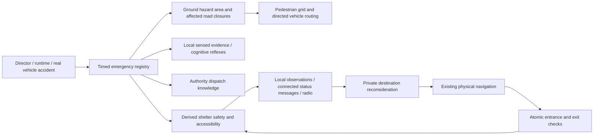

# Phase 5 — dynamic emergencies and shelter management

`emergency_management.gd` coordinates the existing event, admission, perception, road, vehicle, authority and shelter-life systems. It preserves the S1–S5 identities, configured capacities, 100-person default, seeded runs, nuclear timing, AI boundary and existing replay formats. Occupancy is not used as a visual effect or edited to imply evacuation.

## Director controls

Start the simulation, open the Director settings panel, and scroll below the nuclear controller to **Dynamic Emergencies**. Choose an event, camera focus or shelter target, duration and affected radius, then press **Trigger emergency**. **Clear last triggered event** removes that event's effects. Events run on simulation time and pause with the simulation.

The selected-shelter controls can open or close admissions and open an exit only. Opening admissions requires a safe operational shelter; opening an unsafe shelter's exit does not grant admission to new arrivals.

Accident injection selects an existing vehicle; it does not spawn a wreck or an extra driver. The vehicle's actual health/status, passengers, accident scene and existing response system are updated. Clearing the event does not repair that vehicle or erase its independently managed accident closure.

## Runtime API

```gdscript
var closure = manager.add_emergency("road_closure", road_point,
    {"radius": 60.0, "duration": 90.0})
var fire = manager.add_emergency("fire", manager.shelter_by_id.S3.position,
    {"shelter_id": "S3", "severity": 0.8, "duration": 120.0})
manager.add_emergency("increasing_threat", hazard_point,
    {"severity": 0.2, "growth_per_second": 0.01, "duration": 60.0})
manager.add_emergency("evacuation_order", neighborhood_center,
    {"radius": 250.0, "duration": 60.0})
manager.emergency.clear_event(closure)
manager.emergency.set_shelter_condition("S2", "UNSAFE", false)
manager.emergency.set_admissions("S3", true) # Explicitly open a safe alternative.
manager.emergency.open_exit("S2")          # Succeeds only if physical access permits.
```

`add_emergency` returns an event ID, or an empty string for rejected input. It accepts `explosion`, `fire`, `accident`, `road_closure`, `danger_zone`, `infrastructure_failure`, `increasing_threat`, `shelter_closure`, `shelter_unsafe` and `evacuation_order`. An accident requires a valid `vehicle_id`; repeated notifications for the same accident reuse its ID. Position, severity, radius, duration, target and growth are validated, and concurrent dynamic events are bounded.

Existing seeded events remain scheduled by `environment_events.gd`. Dynamic events use absolute simulation timestamps and are processed separately, so they do not accidentally inherit a siren-relative start time. Existing random road incidents now install actual route closures as well as observation cues.

## Event effects and ownership



- Road closures, ground fire/explosion zones, dangerous zones, increasing threats and untargeted infrastructure failures block the actual affected ground-road edges. Their pedestrian hazard areas invalidate cached routes. Road barriers are projected onto the affected road geometry rather than placed arbitrarily beside it.
- Each event owns its own closures. Clearing one cannot reopen an edge still blocked by another emergency, a wreck or a police restriction. Clearing the final closure updates the pedestrian grid, restores connectivity and triggers reconsideration.
- Explosions change nearby actual agent health/stress and can damage actual vehicles through the existing accident runtime. Fire damage is accumulated and applied at one-second intervals. These are configurable fictional simulation effects, not physical blast/fire engineering models.
- Agent perception reads event positions, severity, confidence and timestamps. A person within a hazard field can sense danger locally even without seeing its source; this observation uses the person's own position rather than revealing a hidden source. Escape routes remain constrained by geometry and speed. Enclosed agents request a physical building exit.
- Dispatch receives sourced incident locations. The existing police policy may consider additional restrictions only through its evacuation-access and emergency-access checks; it reconsiders restrictions when their source event clears.
- Existing accidents register with the emergency registry without being simulated twice. Actual vehicle recovery clears the corresponding event notification.
- A local evacuation order can activate evacuation during `LIVING` without starting a nuclear countdown. Pedestrians use actual exits/routes; existing occupied vehicles retain their physical travel and disembark interfaces. Ordered evacuees arriving at a parking location continue on foot rather than repeatedly reboarding.

The new area closures model ground hazards. They do not introduce bridge-collapse geometry or a fire-spread fluid model. Shelter life receives unsafe/emergency/fire flags through its existing routines. Post-impact residents can transfer through the existing room graph and entrance connector when they know a safe, available alternative and their exit is open. A sealed exit or lack of a verified alternative keeps the resident inside and preserves occupancy. The coordinator never forces a nuclear door open.

## Shelter state and capacity

Each shelter now exposes:

| Field | Meaning |
|---|---|
| `capacity` / `maximum_capacity` | Actual configured maximum |
| `occupancy` / `current_occupancy` | Number of admitted identities |
| `available_capacity` | Nonnegative remaining places |
| `safety_status` | `SAFE`, `WARNING`, `UNSAFE`, or destruction status |
| `accessible` | Existing entrance is available and open |
| `operational` / `operational_status` | Service state, including failure/full status |
| `accepting` | Existing scenario/phase admission permission |
| `admission_open` | Combined safety, accessibility, capacity and phase-permission result |
| `entrance_position` / `exit_position` | Physical threshold positions; existing vaults share a portal |
| `admission_rules` | Documents the required operational, safe, open-door and capacity checks |

`shelter_admission.gd` is the atomic boundary. The agent must physically reach the entrance, satisfy admission conditions, and have an unused place before its identity is appended. Simultaneous arrivals retain deterministic arrival-time/priority handling. Rejection never increments occupancy. Available capacity and current occupancy are projected from the actual state after admission.

Unsafe residents are asked to evacuate. They remain admitted until they reach an open exit. Interior residents walk through the room graph and entrance connector, with a gradual height transition to ground level. Only `try_exit()` removes their identity; a blocked door leaves both position and membership intact. A successful departure releases a real place and causes a new availability notification. No count is decremented merely because an evacuation order was sent.

The shelter being evacuated is excluded until the agent reaches a different shelter, so an evacuation order cannot cause an immediate exit/re-entry loop. Post-impact choices additionally require acquired confirmation of existence, safe status and sufficient confidence; unverified rumors do not qualify. These private constraints are included in the AI projection and enforced by both action validators.

Post-impact transfers then use the outdoor route and the destination's ordinary capacity/safety checks. On admission, the survivor resumes accommodation movement and routines with existing health, needs and relationships preserved. A tick spent reaching the exit cannot also spend a second movement budget outdoors. S5's secure entrance is recognized as an entrance by the room-navigation adapter.

Overlapping hazards combine conservatively: a mild warning cannot downgrade an active unsafe event. Clearing a severe event leaves any remaining warning or failure in place. Existing structural destruction is not repaired by clearing a temporary event.

The shelter cards, status lamps and inspector show availability, safety, access and entrance/exit information. Observer-masked shelter inspection retains its existing information boundary.

## Destination decisions and information boundaries

The coordinator publishes capacity, access and safety transitions rather than broadcasting every individual admission. Local observers can acquire exact observed capacity; connected civilians can receive a sourced status message; authorities receive control reports. Distant offline agents are not silently updated. S5 status is not sent to a distant recipient who only knows it as an unverified rumor.

Incoming agents with relevant new information reconsider immediately through local rules; their next contextual AI decision can refine that plan. Existing asynchronous model outputs are still validated against the agent's current beliefs. The AI projection explicitly includes acquired `accessible` and `safety_status` belief fields, not the complete shelter registry.

Choices continue to use available route length, subjective urgency, personality, resources, capacity estimates, safety, official support, recommendations and observed crowds. Private remembered family locations now add bounded support to nearby shelter choices. Unknown or stale family positions do not become live world tracking.

A navigation revision forces route replacement even when the preferred shelter ID stays the same. Agents with no known option remain eligible to decide again, and a received availability-restored report wakes waiting evacuees. Local non-nuclear evacuation uses a fixed planning horizon rather than a hidden nuclear deadline.

## Configuration, recording and compatibility

`resources/emergency_management.json` controls concurrent event count, status-message reach, default radius, explosion/fire damage and status-history limits. It does not change occupancy, shelter IDs, population composition or scenario capacities.

`simulation_manager.gd` applies event transitions before movement/admission in each fixed tick. The coordinator holds a weak manager reference. Ordinary complex reasoning remains in the existing bridge/LangGraph architecture; there are no per-frame model calls.

Frame recordings include environmental event state. Playback restores those snapshots and bypasses live event decisions. Older frames without the new field remain readable. This preserves the existing replay mechanism; it does not add general checkpoint resume or repair previously audited post-impact recording gaps.

## Validation

Godot 4.7.2 checks executed for this phase:

| Test | Result |
|---|---|
| `test_dynamic_emergencies.gd` | 59 checks passed: capacity races, movement budgets, private information, dispatch, blocked/unsafe exits, reopening, expiry, overlapping closures, simultaneous hazards, escalation, actual accidents, idempotence, family choices, local orders, and physical post-impact interior-to-shelter transfers |
| `test_phase5_ui.gd` | 9 checks passed, including triggering and clearing a real shelter closure through the Director control |
| `test_daily_shelters.gd` | 13 checks passed |
| `test_phase62.gd` | 1,415 vehicle checks passed |
| `test_phase64.gd` | 36 authority checks passed |
| `test_moroccan_traffic.gd` | 40 traffic checks passed |
| `test_agent_cognition.gd` | 31 cognition checks passed |
| `test_city_navigation.gd` | 97 navigation checks passed |
| `test_phase5.gd` | 879 checks passed for the exercised social/replay trajectory |

Python: 39 tests passed across cognitive contracts, LangGraph, service behavior, reference models and population generation. Existing engine cleanup warnings, replay exponent warnings and SQLite cleanup warnings remain. No live-model or ten-day disaster soak was performed in this phase.

The new capacity test walks existing outdoor civilians along real routes before admitting them. Capacity is configured as part of the fixture before arrivals; occupancy is never assigned to manufacture fullness. Legacy fixture tests are retained separately.

```powershell
godot --headless --path . --script tests/test_dynamic_emergencies.gd --quit-after 600
godot --headless --path . --script tests/test_phase5_ui.gd --quit-after 600
./tools/graphify.ps1 build
```
