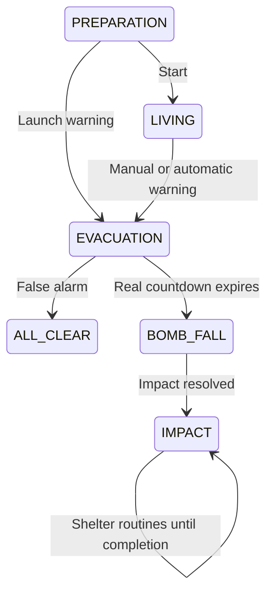
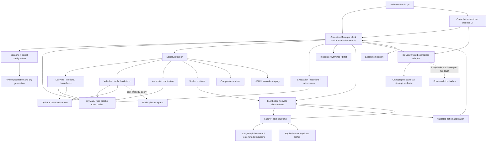

# ESSAIM — Phase 1 project audit and implementation plan

Audit date: 2026-11-11. Scope: the current working tree, including existing uncommitted and untracked development work. This report does not represent only the last Git commit. No runtime scripts, scenes, configuration or assets were changed for this audit.

## 1. Assessment

ESSAIM already has a substantial simulation. Keep its fixed-clock Godot runtime, continuous map coordinates, seeded population/geography, S1–S5 admission model, private agent observations and asynchronous inference boundary. Extend these systems incrementally. A replacement simulation or a compulsory movement grid would introduce unnecessary compatibility risk.

The active default remains **100 people: 65 civilians and 35 authorities**, confirmed in both `resources/social_config.json` and the cached `resources/social_population.json`. The older `resources/phase1.json` specifies 150 agents/4 authorities; `config/simulation.json` specifies 1,000 people for Python models. These are separate configuration paths, not the active social default. `SimulationManager.initialize_run()` overrides the older Godot population settings when `phase5_enabled` is true.

The earlier isometric camera conversion is already present. Its angle is fixed at 45° yaw/35.264° elevation with orthographic projection. That does not mean the entire isometric conversion, occlusion behavior or performance work is complete.

The most urgent work is correctness and compatibility at subsystem boundaries. In particular, shelter routines are not yet a verified ten-day feature. There are concrete defects in their room availability, needs schema, resource effects and test coverage. There is also a collision query boundary between the root viewport and the independent 3D viewport that needs an integration test before scenery changes.

## 2. Scope and evidence

The [file inventory](AUDIT_FILE_INVENTORY.md) covers 267 project-owned files at inventory time: 14 scenes, 126 GDScript files including tests, 49 Python files, 20 JSON files, one shader, 17 SVGs, five audio assets, three PowerShell tools and documentation/support files. UID/import sidecars, `.godot`, dependencies, generated outputs, tool checkouts and secrets are excluded from the main tables. Source/resource references and Python syntax received a structural pass; the runtime paths discussed below received targeted source review. Binary asset contents were not visually or acoustically certified.

Graphify was used for navigation. Its report records unresolved possibilities for dynamic signals/calls; graph edges were verified against source rather than treated as proof. No wiki index was available, so the graph report, queries and source inventory provided broad navigation. No missing literal `preload("res://...")` or `load("res://...")` targets were found in the indexed source.

Godot 4.7.2 is installed under the user's `Downloads/godot` directory. Earlier documentation that inferred its absence from PATH was incorrect. Tests below used its console executable. Performance concerns in this report are source-based cost/risk findings, not measured FPS or GPU benchmarks.

## 3. Runtime architecture

### Entry, ownership and communication

`project.godot` launches `scenes/main.tscn`, a Control with `scripts/main.gd`. Most UI and world nodes are created programmatically. There are no configured autoloads. The renderer is GL Compatibility; the configured viewport is 1280×900 with canvas-item stretching and a 1024×720 minimum window.

`main.gd` creates the simulation manager and the 3D view, connects signals, and builds controls/inspectors. `simulation_manager.gd` owns agent and shelter arrays, elapsed time, phases, seed, run initialization, admissions, impact outcomes and archives. Its signals include `run_initialized`, `clock_changed`, `simulation_updated`, `event_logged`, `setup_failed`, `siren_activated`, `bomb_fall_started`, `impact_occurred` and `all_clear`.

`social_simulation.gd` coordinates families, phones, social beliefs, vehicles, authority behavior, everyday life and companions. It holds a manager reference and shares agent dictionaries through `by_id`. Its subsystem objects mutate these same records. This is a direct-call/shared-state architecture with signals at the UI boundary; it is not an entity-component framework or a fully event-sourced simulation.

`emit_event()` creates versioned social events, adds them to history and the recorder, and queues transport to the Python service. These events provide observability; replay mostly restores frame snapshots rather than recomputing the world from events.

### Clock and phases

The manager accumulates frame time multiplied by simulation speed and advances a 0.1-second fixed step. Vehicles receive substeps of at most 0.05 seconds. Much social work is staggered to once per simulation second. Routine time uses a separate rate, currently 60 in-world seconds per simulation second. Ten shelter days therefore correspond to 14,400 simulation seconds at that rate; wall time also depends on the speed selector. Bomb fall has its own frame-time progression. These time domains must be explicitly preserved and tested during any refactor.

Seeded RNG streams drive initialization, geography and events. Seed equality alone does not guarantee identical live LLM runs: external responses, their ordering, latency and model behavior can differ. Recorded decisions/frames are required for reproducible AI comparisons.

### System ownership map

| System | Main implementation | Dependencies and behavior |
|---|---|---|
| Population and civilian identity | `social_config.gd`, `ai_service/social_population.py`, `agent_personality.gd` | Cached or NumPy-generated population; roles, occupations, family links, traits and synthetic IQ. 17 personality archetypes with continuous trait variation. |
| Everyday civilian life | `daily_life.gd`, `building_interiors.gd`, `civilian_activity.gd`, `spontaneous_actions.gd` | Schedules, indoor/outdoor transitions, needs, walking and optional OpenJev choices. Older activity code remains in manager fallback/emergency paths. |
| Families and communication | `social_simulation.gd`, `household_travel.gd`, `rumor_system.gd` | Contacts, phone delivery, trust, reunions, school groups, household travel, boarding and abandonment decisions. |
| Authorities and police | `authority_coordination.gd`, `police_response.gd`, `social_simulation.gd` | Assignments, reports, command orders, emergency access, managed roadblocks, response priorities and family-related duty decisions. Police, Medical, Fire, Civil protection and Crisis commander occupations are used. |
| Vehicles | `vehicle_catalog.gd`, `vehicle_runtime.gd`, `vehicle_collisions.gd`, `traffic_rules.gd`, `parking_layout.gd` | Vehicle dimensions/state, swept collisions, spatial lookup, lanes, junctions, signals, parking, accidents, casualties and response. Household travel supplies passengers and destinations. |
| Geography/navigation | `city_map.gd`, `road_graph.gd`, `road_routes.gd`, `ai_service/city_generator.py`, `ai_service/road_geometry.py` | Seeded procedural map, road graph, terrain, closures, obstacle indices, cached continuous routes and pedestrian free-space grid. The 3D nav region mirrors this data. |
| Evacuation | `evacuation_decisions.gd`, `agent_reactions.gd`, `llm_actions.gd`, manager | Rule scores or validated model intentions, perception, movement, route changes, admission and rejection. |
| Shelters | `shelter_admission.gd`, `shelter_state.gd`, manager | Existence, capacity, occupancy, door/maintenance state and supplies. Admission truth is separate from agent beliefs. |
| Post-impact shelter life | `shelter_life.gd`, `resources/shelter_life.json` | Needs, activities, room routes, family interactions, system maintenance and limited complex AI decisions; incomplete/defective areas are listed below. |
| Emergency events | `environment_events.gd`, `warning_system.gd`, `blast_model.gd` | Seeded maintenance/door/road/crowd/rat incidents, audible warnings, real/false alarm, impact damage and survival. |
| Companion | `animal_companion_runtime.gd`, `three_d/animal_companion_3d.gd` | Named German Shepherd, owner relationship, travel and impact behavior. |
| Private beliefs and memory | `agent_beliefs.gd`, `agent_observation.gd`, `rumor_system.gd` | Local evidence, remembered locations, provenance, trust, personal memory and whitelisted observation packets. |
| AI bridge | `llm_bridge.gd`, `llm_actions.gd` | HTTP health, bounded concurrent requests, run/request identity, age checks, local fallback and authoritative action application. |
| AI service | `ai_service/main.py`, `runtime.py`, `langgraph_decisions.py` | FastAPI, per-agent async actors, model groups, private retrieval/tools, structured validation and LangGraph decisions. |
| AI storage/inspection | `events.py`, `traces.py`, `social_events.py`, `inspector.py` | SQLite ledger/social events, traces, optional Kafka, HTTP inspector and metrics. |
| Presentation | `map_view_3d.gd`, `three_d/*` | 3D world in a SubViewport, procedural models, interpolation, picking, camera, lighting, cutaways, effects and warning audio. |
| UI/debugging | `main.gd`, `dashboard.gd`, `social_dashboard.gd`, `object_inspector.gd`, city/nuclear/siren controls | Director controls, configuration, agent inspection, traces, exports, replay, road debug (F8), shelter cutaway (I), follow (F). |
| Persistence | `social_recorder.gd`, `experiment_log.gd`, `social_config.gd`, social replay functions | Worker-thread JSONL frames/events, immutable experiment exports and scenario presets. See replay limitations below. |

### Dependency map

Solid arrows below identify direct calls, data ownership or transport; the labeled physics edge is an exception to the intended presentation boundary.

The view mostly observes simulation records, but it is not completely isolated. `vehicle_runtime.physics_query()` consults a Godot physics world. Also, several models and UI components directly read the manager/social objects. An architectural change must account for these actual dependencies, rather than rely only on comments describing a read-only renderer.

## 4. Scenes, assets and presentation

The 14 scenes include the main UI; older 2D agent/shelter scenes; 3D agent/building/city/shelter/camera scenes; warning siren; valley; vault entrance/door; and floor vault/door. Detailed scene roots and references are in the inventory. Many vehicles, interiors, lights and visual markers are generated directly in scripts, so scene count understates the runtime hierarchy.

The project-owned asset set is mainly SVG controls and warning audio. Most world art is procedural geometry built with `three_d/geometry.gd`, not imported production character/building meshes. Existing materials use rough StandardMaterial3D surfaces; geometry helpers reuse box meshes but create materials per instance. Vegetation and some building details already use MultiMesh. Detail visibility ranges already exist for agents, windows and vegetation. Preserve these optimizations while measuring their effectiveness under orthographic zoom.

Keep `world_coordinates.gd` as the explicit mapping: simulation XY → Godot XZ at scale 0.1, with map elevation added separately. Vehicles have heading, body offset and transport height conventions. Changing model scale, floor elevation or collider orientation independently would risk visible/physical disagreement.

## 5. Compatibility contracts to preserve

| Contract | Current value/behavior |
|---|---|
| Default active population | 100 = 65 civilians + 35 authorities; includes 10 children, not 10 extra agents |
| Stable shelters | S1: 125, S2: 37, S3: 90, S4: 175, S5: 250 nominal capacity |
| S5 existence | Seeded probability 0.5; absent shelter capacity is zeroed by initialization |
| Shelter stock unit | Person-days; S1 nominal stock 2,000 person-days; unknown/abundant stocks resolved by existing logic |
| Simulation clock | 0.1-second fixed step; speed selection and pause/resume owned by manager |
| Information boundary | Agent beliefs/memory are distinct from director truth; private observation whitelists and action validation remain mandatory |
| Asynchronous AI | Simulation continues in async mode; intentional sync experiments may wait for pending standard requests |
| Geometry | Continuous coordinates and existing routes/collisions remain authoritative; visual conversion must be reversible |
| Existing persistence | Presets, JSONL replay and experiment archives must remain readable; introduce versions/migrations before changing formats |
| Existing UI | Director view is currently hardcoded true in `main.gd`; do not assume a complete switchable observer mode |

## 6. Findings and repair priorities

**Confirmed** means directly reproduced or established from source. **Risk** means the implementation warrants an integration test/profile; it is not a measured failure claim.

| Priority / evidence | Finding and consequence | Source / recommended action |
|---|---|---|
| High — reproduced | `test_shelter_life.gd` cannot compile: inferred `family_room` type is unresolved at line 67. Ten-day coverage therefore does not currently execute. Its final scenario disables agents and jumps the clock, so even after compilation it is not a full ten-day behavioral soak. | Repair the test, then add bounded multi-shelter progression, resource and UI checks before declaring the feature complete. |
| High — confirmed | Shelter `_update_needs()` replaces the needs dictionary with a smaller schema. `object_inspector.agent_text()` still directly reads `safety`, `family` and `social_attachment`. Inspecting a post-impact survivor can encounter missing keys. | `shelter_life.gd`, `object_inspector.gd`: define compatible needs fields and validate phase transitions. |
| High — confirmed | `REST` has scores/effects but no `ROOM_TYPES` entry. S3 has no Dormitory/Family bedroom for SLEEP. S5 calls entrance lookup using `Entrance` while its plan uses `Secure entrance`; initial routing has no valid start. | `shelter_life.gd`: validate all activity-room mappings and entrances for every S1–S5 layout. |
| High — confirmed | Configured stress effects are negative, but socializing/exercise/reflection subtract them, increasing stress. `refuge.fire` is read without an initialized default on the generic emergency response path. | `resources/shelter_life.json`, `_complete_activity`, `_socialize`, `_handle_emergency`: adopt one effect-sign convention and initialize all system state. |
| High — source mismatch, runtime impact needs verification | Vehicle physics queries use `tree.root.find_world_3d()`, while the rendered city uses `SubViewport.own_world_3d=true`. Scene-only obstacle casts can inspect a different world; planar collision checks may mask the issue. | `vehicle_runtime.physics_query`, `map_view_3d._ready`, `social_world.gd`: test identical collisions with/without the view. Decide on an explicit collision-world dependency before relocating any colliders. |
| High — confirmed mathematical mismatch | Occlusion rays start at `camera.global_position` for every agent. Orthographic viewing rays should be parallel and start at the agent's projected screen position. The perspective-style rays can fade the wrong building. | `map_view_3d._process`: use camera projection methods, then test occlusion and picking together. |
| High — confirmed coverage gap | IMPACT returns early from social ticking, bypassing periodic frame recording. Finalization records a final frame but not the ordinary interval of shelter frames. Replay does not restore shelter runtime RNG, decision timers, room reservations or pending work. | `social_simulation.tick/load_replay/apply_replay_frame`, `shelter_life.gd`: preserve replay and explicitly design checkpoint/resume separately. |
| Medium — confirmed | Every shelter room receives the whole shelter capacity; presentation has separate room capacities and a duplicated layout. Stock consumption changes `person_days` without synchronizing the older `supply_level` shown by inspectors/exports. | Share room definitions, distinguish admission from room capacity, and establish one stock owner with compatible projections. |
| Medium — confirmed | Treatment grants health without checking staff/medicine. Some productive activities have labels/animations but no corresponding completion effect. CONSERVE/SHARE model choices set a flag that resource consumption does not consult; leadership requests emit an event without a complete resolution workflow. | Complete activity prerequisites/effects incrementally; do not advertise these as fully implemented subsystems. |
| Medium — observed symptoms / suspected ownership cause | Godot regression exits report 51–71 leaked objects and 10 resources still in use. Shelter life holds a strong social reference while social owns shelter life; several other subsystems already use WeakRef. `social.close()` does not stop shelter life. | Audit teardown, requests, RefCounted cycles and worker ownership. The exact allocation sources need verbose tracing. |
| Medium — confirmed architecture limitation | Replay reads frames into memory and updates existing agents by array index and minimum count. It assumes a matching initialized world/population. It is not a general saved-game resume loader. | Add identity/schema validation now; design versioned checkpoint data and migration tests before promising cross-scenario resume. |
| Medium — confirmed packaging risk | Generation invokes Python synchronously using `.venv/Scripts/python.exe` or `python3`. Logs/archives write under `res://outputs`, which may be unwritable in an exported game. | Define supported deployment targets, interpreter/generator packaging and a `user://` output policy with old-path compatibility. |
| Medium — risk | Fixed-step catch-up has no per-frame budget. Slow frames can perform more simulation work and amplify stalls. Recorder snapshots are deep-copied on the calling thread, and its queue is unbounded. | Profile step time and queue depth first. Bound work without skipping simulation ticks; choose explicit recording backpressure behavior. |
| Medium — source cost | 3D navmesh construction loops every raster cell against obstacles. Closure revisions rebuild it. Per-frame visual synchronization touches all agents/vehicles, including debug-label strings; occlusion resets all buildings and casts rays for visible agents every 0.3 seconds. | Cache/index/chunk measured hot paths; throttle visual detail work independently of simulation. Frustum culling of meshes does not eliminate script processing. |
| Medium — source cost | Shelter choices repeatedly scan residents/families and perform room BFS for candidates; critical active agents can re-evaluate outside the intended interval via the extra critical-condition clause. | Cache reachable rooms, index residents and honor explicit decision cadence while preserving urgent events. |
| Medium — confirmed | Director mode is hardcoded on. `world_projection.gd` supports masking but the current 3D run receives actual shelter records. An observer UI cannot safely be enabled by changing one boolean. | Route every observer-facing projection through a tested visibility boundary, especially S5 existence and supplies. |
| Low — confirmed | Legacy config names, comments and documentation disagree with current features; e.g. inspector text says daily rationing is not modeled. One older report is CP1252 rather than UTF-8. | Update documentation as each subsystem is repaired; distinguish current contracts from historical phase notes. |

### Overlap and duplication

Do not delete any of these merely because they overlap:

- `map_view.gd`, 2D agent/shelter scenes and their visual scripts coexist with the active 3D view and older regression tests. Treat them as legacy adapters until their consumers are mapped.
- Python `models/*` and `config/*.json` represent older/reference model contracts; they are not the active Godot simulation owner.
- `ai_service/engine.py`, `provider.py`, `pool.py` and `server.py` retain compatibility/test paths. Docker launches `ai_service.main:app` using `AsyncRuntime`; `server.py` explicitly identifies its legacy test transport. Some provider/environment helpers are still imported by current code.
- Everyday behavior, older civilian reactions and shelter activities each mutate needs and goals. Phase dispatch exists, but their schemas/time units are not uniformly enforced.
- Shelter room plans are duplicated between behavior and presentation. The 2D routing grid and 3D navigation mesh are deliberate representations of one world, but have separate rebuild costs and consistency risks.
- Social JSONL, experiment JSON, SQLite ledgers and traces serve different purposes. Consolidation should begin with schema/ownership documentation rather than deleting a recorder.

## 7. Validation performed

Existing tests were run without modifying their fixtures or runtime code:

| Check | Result and limits |
|---|---|
| `tests/test_phase5.gd` | 1,000 checks, zero assertion failures; replay emitted `Exponent too high` warnings and shutdown reported leaks/resources still in use. |
| `tests/test_phase62.gd` | 1,415 checks, zero failures; shutdown cleanup warnings. Covers vehicle/collision behavior, not rendered-scene physics-world equivalence. |
| `tests/test_phase64.gd` | 36 authority checks, zero failures; shutdown cleanup warnings. |
| `tests/test_phase65.gd` | 35 named-agent/companion checks, zero failures; shutdown cleanup warnings. |
| `tests/test_shelter_life.gd` | Failed to load due to the line-67 type-inference parse error; no behavioral pass claimed. |
| Python models, social population, LangGraph cognition, AI service | 32 tests passed; Python reported an unclosed SQLite connection at process exit. Provider tests use controlled fixtures; this is not a live LLM certification. |
| Structural checks | Python source parsed; population/cache counts and S1–S5 values verified; literal resource targets exist. |
| Earlier startup repair in this session | UI test: six checks passed; isometric camera test: zero failures. These establish startup, not full visual correctness. |

Not performed: interactive scene-by-scene visual QA, audio listening, live cloud/model inference, GPU/render profiling, export packaging validation, or a complete ten-day survivor soak. Test exit code alone must not override script errors or engine cleanup messages.

## 8. Implementation plan and proposed components

The precise specifications for the next six phases have not been supplied in this message. The following six work packages are a recommended dependency order, not an assumption that they replace future phase briefs. Each preserves the existing implementation and has a measurable exit gate.

| Order | Work and files likely to change | Proposed component / exit gate |
|---|---|---|
| 1. Stabilize current contracts | `shelter_life.gd`, `object_inspector.gd`, `social_simulation.gd`, shelter test/config, lifecycle ownership | Add an additive `SimulationRecordSchema` validator/helpers for needs, health, room and timing fields. Fix confirmed defects. Gate: startup plus all S1–S5 routine tests execute; baseline 100/65/35, seeded admissions and private observations preserved. |
| 2. Establish rendering/collision boundary | `vehicle_runtime.gd`, `map_view_3d.gd`, `three_d/social_world.gd`, `world_coordinates.gd` | Explicit `CollisionWorldAdapter` or equivalent injection into the existing runtime. Preserve current planar collision rules. Gate: equal collision outcomes with the visual view attached/detached and correct road/height alignment. |
| 3. Complete isometric presentation integration | `director_camera.gd`, `map_view_3d.gd`, `building_3d.gd`, `shelter_3d.gd`, `shelter_interior_3d.gd`, visual config | Shared shelter room definition resource; a view-only occlusion controller. Gate: orthographic picking/fading, follow at interior height, readable silhouettes, no hidden-state leaks, no changed simulation results from camera movement. |
| 4. Finish activities and AI event contracts | `shelter_life.gd`, `daily_life.gd`, authority coordination, bridge, service shelter graph/runtime | Incremental activity descriptors with requirements/effects; bounded complex-event decisions with explicit local fallback. Gate: real navigation/attendance, staff/resource requirements, emergency interruption, family interactions and ten-day progression with active agents. |
| 5. Harden persistence and replay | `social_recorder.gd`, `experiment_log.gd`, social replay, AI run lifecycle | A versioned `RunSnapshotCodec` plus checkpoint manifest with entity IDs, map/config version, clocks, RNG states and subsystem state. Gate: old replay fixtures remain readable; resume determinism checked in rules-only mode; external requests are safely reissued/invalidated. |
| 6. Profile, optimize and package | View synchronization, geometry/material factory, navmesh adapter, recorder, generation launchers, deployment docs | Visual update budget/profiling counters, spatially chunked repeated geometry where measured useful, explicit runtime dependency discovery. Gate: measured frame/step/recording budgets on named hardware, clean teardown, successful exported startup and preserved simulation outcomes at 100 agents before larger runs. |

Before starting each package, capture the relevant baseline and update only its boundary. Additive schema adapters and explicit ownership should precede class extraction from the large coordinator files. Avoid a wholesale dictionary-to-object migration, replacement pathfinder, or single new scheduler spanning every phase in one patch.

### Acceptance checklist for future phases

- Retain 100/65/35 defaults, occupations, identities, family links and personalities.
- Preserve S1–S5 identifiers, nominal capacities, S5 uncertainty and admission rules.
- Compare same-seed local-rule traces; record accepted model decisions when assessing AI runs.
- Verify pause/resume, warnings, false alarm, evacuation, bomb fall, impact and shelter completion independently.
- Exercise moving families, road closures, emergency vehicles, collisions and authority responses together.
- Move/zoom the camera while simulation runs and confirm authoritative outcomes do not change.
- Validate private model inputs and observer projections against director-only information.
- Keep old preset/replay/export fixtures and add schema migrations before format changes.
- Separate assertion passes from engine errors, cleanup warnings and live-service availability.

## 9. Audit deliverables

This report provides the current architecture, dependency map, confirmed defects, risk register, compatibility contracts and implementation sequence. `AUDIT_FILE_INVENTORY.md` provides the scene/script/config/asset/test catalog. Runtime repairs are intentionally proposed rather than applied in this audit.
